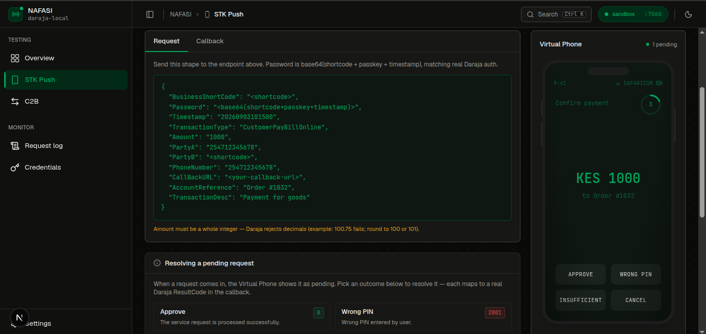
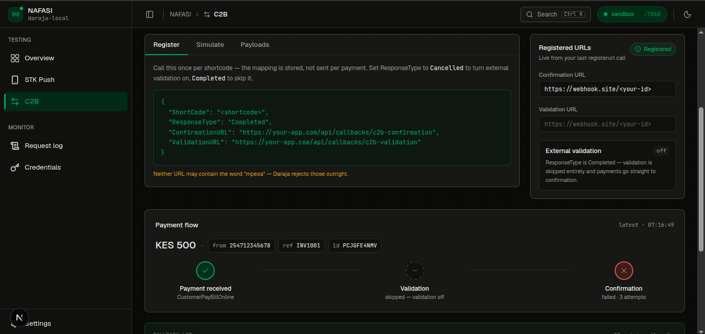
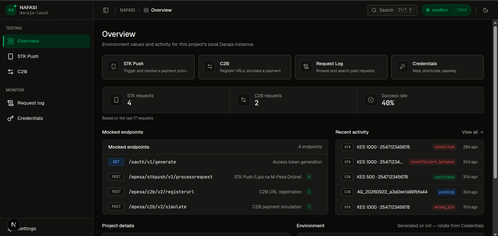

# Daraja Local

[](https://github.com/knnedy/daraja-local/releases)
[](LICENSE)

A local, offline emulator of Safaricom's M-Pesa Daraja API. Build and test STK Push and C2B integrations without a public callback URL, a test phone, or any sign-up. One binary, nothing else to run.

Testing against Safaricom's sandbox means exposing a public callback URL and having no way to make a payment fail on demand. Daraja Local runs on your machine, speaks the same API, and lets you choose what happens: approve a payment, fail it with a wrong PIN, let it time out, or reject a C2B payment from your own validation endpoint.


_STK Push: a pending request on the Virtual Phone. You choose the outcome._

---

## Quickstart

**1. Install and run**

```bash
curl -fsSL https://raw.githubusercontent.com/knnedy/daraja-local/main/install.sh | sh
daraja-local
```

Open the URL printed at startup (`http://127.0.0.1:7060` by default).

**2. Create a project.** Daraja Local generates a consumer key, consumer secret, shortcode and passkey for it.

**3. Copy the environment values** from the Overview page into your app:

```
DARAJA_BASE_URL=http://127.0.0.1:7060
DARAJA_CONSUMER_KEY=...
DARAJA_CONSUMER_SECRET=...
DARAJA_SHORTCODE=...
DARAJA_PASSKEY=...
```

Point your M-Pesa client at `DARAJA_BASE_URL` instead of `https://sandbox.safaricom.co.ke`. If your code hardcodes Safaricom's URL, make the base URL configurable first.

**4. Send an STK Push** (with the variables above exported):

```bash
TOKEN=$(curl -s -u "$DARAJA_CONSUMER_KEY:$DARAJA_CONSUMER_SECRET" \
  "$DARAJA_BASE_URL/oauth/v1/generate?grant_type=client_credentials" \
  | grep -o '"access_token":"[^"]*"' | cut -d'"' -f4)

TIMESTAMP=$(date +%Y%m%d%H%M%S)
PASSWORD=$(printf '%s%s%s' "$DARAJA_SHORTCODE" "$DARAJA_PASSKEY" "$TIMESTAMP" | base64 | tr -d '\n')

curl -X POST "$DARAJA_BASE_URL/mpesa/stkpush/v1/processrequest" \
  -H "Authorization: Bearer $TOKEN" \
  -H "Content-Type: application/json" \
  -d "{
    \"BusinessShortCode\": \"$DARAJA_SHORTCODE\",
    \"Password\": \"$PASSWORD\",
    \"Timestamp\": \"$TIMESTAMP\",
    \"TransactionType\": \"CustomerPayBillOnline\",
    \"Amount\": \"100\",
    \"PartyA\": \"254712345678\",
    \"PartyB\": \"$DARAJA_SHORTCODE\",
    \"PhoneNumber\": \"254712345678\",
    \"CallBackURL\": \"http://localhost:4000/payments/callback\",
    \"AccountReference\": \"Order-1\",
    \"TransactionDesc\": \"Test payment\"
  }"
```

As in the real API, every request field is a JSON string. `CallBackURL` can be any URL your machine can reach, including `localhost`, so you don't need a tunnel.

**5. Resolve it.** The request appears in the Virtual Phone on the STK Push page. Choose Approve, Wrong PIN, Insufficient balance or Cancel, or do nothing and it times out. Daraja Local then POSTs the callback to your `CallBackURL`, and every step is recorded on the Request Log page.

---

## Features

- **Single binary, fully local.** Nothing to sign up for. It listens on `127.0.0.1` only, and your data stays in `~/.daraja-local`.
- **Per-project credentials.** Each project has its own consumer key, secret, shortcode and passkey, plus its own settings and request history. Rotate them any time from the Credentials page.
- **STK Push with a Virtual Phone.** Requests wait on a simulated handset and you pick the outcome. Each outcome returns the real Daraja ResultCode. Several pending requests can be open at once.
- **Real callbacks.** Delivered to your `CallBackURL` over HTTP, retried on failure.
- **C2B, end to end.** Register your URLs, simulate a payment, optionally validate it against your own `ValidationURL` (with Daraja's `ResponseType` fallback rules), then deliver the confirmation.
- **Daraja-shaped validation and errors.** The password check, phone and amount rules, and Daraja's error codes and HTTP statuses are reproduced, so a malformed request fails the way it would against Safaricom.
- **Request Log.** Every request, response and callback, grouped by transaction. Filter by type and status, search by phone number, reference or ID, page back through history, and copy any payload.
- **Live dashboard.** Stats, activity and the Virtual Phone update as requests arrive.

---

## Screenshots


_C2B: your registered URLs, and a simulated payment traced through validation and confirmation._


_Overview: live stats, recent activity and your project's credentials._

---

## What's emulated

| API               | Route                                                              |
| ----------------- | ------------------------------------------------------------------ |
| OAuth token       | `GET /oauth/v1/generate`                                           |
| STK Push          | `POST /mpesa/stkpush/v1/processrequest`                            |
| C2B register URLs | `POST /mpesa/c2b/v1/registerurl`, `POST /mpesa/c2b/v2/registerurl` |
| C2B simulate      | `POST /mpesa/c2b/v1/simulate`, `POST /mpesa/c2b/v2/simulate`       |

Not implemented: STK Push query, B2C, B2B, Reversal, Account Balance, Transaction Status.

---

## Documentation

| Guide                                                 | What's in it                                                        |
| ----------------------------------------------------- | ------------------------------------------------------------------- |
| [Getting started](docs/getting-started.md)            | Install, first run, creating a project, finding your credentials    |
| [Using it with your app](docs/using-with-your-app.md) | Pointing your backend at Daraja Local, callback URLs, code examples |
| [STK Push](docs/stk-push.md)                          | Request shape, outcomes and ResultCodes, callbacks, timeouts        |
| [C2B](docs/c2b.md)                                    | Registering URLs, simulating payments, validation and confirmation  |
| [Request Log](docs/request-log.md)                    | Searching, filtering and reading the log                            |
| [Fidelity](docs/fidelity.md)                          | What mirrors Daraja exactly, known quirks, what is emulator-only    |
| [Troubleshooting](docs/troubleshooting.md)            | The errors you'll actually hit and what they mean                   |

---

## Installation

### Script (Linux and macOS)

```bash
curl -fsSL https://raw.githubusercontent.com/knnedy/daraja-local/main/install.sh | sh
```

It installs to `/usr/local/bin` (and asks for `sudo` if needed). To install somewhere else:

```bash
INSTALL_DIR=~/.local/bin sh install.sh
```

Re-run the script any time to update.

### Manual

Archives are named `daraja-local_<version>_<os>_<arch>`:

```bash
VERSION=0.1.0   # replace with the latest release
curl -L https://github.com/knnedy/daraja-local/releases/download/v${VERSION}/daraja-local_${VERSION}_linux_amd64.tar.gz | tar -xz
sudo mv daraja-local /usr/local/bin/
```

Swap `linux_amd64` for `linux_arm64`, `darwin_amd64` or `darwin_arm64` as needed.

### Windows

Download `daraja-local_<version>_windows_amd64.zip` from the [Releases page](https://github.com/knnedy/daraja-local/releases), extract `daraja-local.exe`, and run it from a terminal. There is no Windows ARM build yet.

### Verifying downloads

```bash
curl -fsSLO https://github.com/knnedy/daraja-local/releases/download/v${VERSION}/checksums.txt
grep "daraja-local_${VERSION}_linux_amd64.tar.gz" checksums.txt | sha256sum -c -
```

On macOS, use `shasum -a 256 -c -` instead of `sha256sum -c -`.

### Uninstalling

```bash
sudo rm /usr/local/bin/daraja-local
```

Your projects and logs live in `~/.daraja-local`. Delete that folder to wipe them.

---

## Building from source

**Requirements:** Go 1.27.1+, Node.js 22, pnpm.

```bash
git clone https://github.com/knnedy/daraja-local.git
cd daraja-local
make build
./bin/daraja-local
```

`make build` exports the frontend as static files, embeds them into the Go binary, and compiles to `bin/daraja-local`. For hot reload during development, run `make dev`. See [CONTRIBUTING.md](CONTRIBUTING.md) for the full workflow.

---

## Limits worth knowing

- Daraja Local is for developing and testing your integration. Run it against Safaricom's own sandbox before going live. Its behavior follows Daraja's documented and observed behavior, and a few details, such as callback retry timing and refusing `simulate` before `registerurl`, are emulator choices. [Fidelity](docs/fidelity.md) lists which is which.
- C2B payloads carry no customer details. Name, invoice and balance fields arrive blank, because there is no real subscriber data to draw on.

---

## Tech stack

| Layer        | Technology                                                                                   |
| ------------ | -------------------------------------------------------------------------------------------- |
| Backend      | Go, `chi/v5`, SQLite via `modernc.org/sqlite` (pure Go, no cgo), goose, sqlc                 |
| Frontend     | Next.js (static export), TypeScript, Tailwind CSS v4, TanStack Query, Zustand, Framer Motion |
| Distribution | Single binary via `go:embed`, cross-compiled and released with GoReleaser                    |

---

## Contributing

Contributions are welcome. Please read [CONTRIBUTING.md](CONTRIBUTING.md) first, and open an issue before starting anything large.

## License

MIT © 2026 [knnedy](https://github.com/knnedy). See [LICENSE](LICENSE) for details.

Daraja Local is an independent open-source project. It is not affiliated with, endorsed by, or sponsored by Safaricom. M-Pesa and Daraja are trademarks of their respective owners.
